# ClickMate

[简体中文](README.zh-CN.md) · [Download the latest release](https://github.com/Funnyrz/ClickMate/releases/latest) · [MIT License](LICENSE)

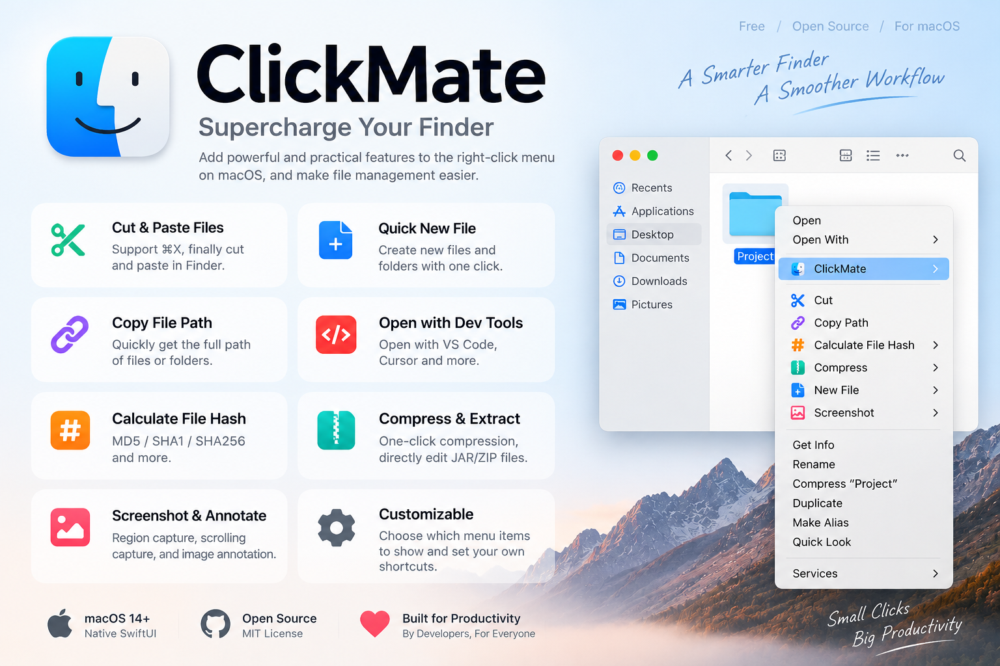

*Feature overview illustration. See the screenshots and descriptions below for the current interface and supported actions.*

ClickMate brings everyday file tools to Finder: create files from templates, copy paths, open folders in your editor, compress selections, and edit text inside ZIP/JAR archives. Finder Cut and screenshot tools add customizable global shortcuts, with native interfaces built using SwiftUI and AppKit.

**Requires macOS 14 or later.** Release packages support Apple silicon and Intel Macs. Xcode is only needed to build from source.

## Install and get started

1. Download the DMG from [GitHub Releases](https://github.com/Funnyrz/ClickMate/releases/latest), copy **ClickMate.app** to **Applications**, and open it.
2. In **Permissions**, choose the tools you want to use and complete their setup. Each tool has its own trial; permission status and the trial result are shown separately.
3. For Finder tools, enable the ClickMate Finder extension in System Settings and authorize the folders you use. Then right-click a file or a blank area in a monitored folder, such as Desktop, Documents, or Downloads.
4. Enable optional shortcuts in **Quick Features**. Complete the corresponding permission setup before trying them.

| Tool | Required setup |
|---|---|
| Finder tools | Finder extension enabled and access to the target folder. Use the folder authorization and disk-access diagnostics when access fails. |
| Finder Cut | Background service enabled, with **Accessibility** permission for **ClickMate Background Service**. |
| Screenshots | Background service enabled, with **Screen Recording** permission for **ClickMate Background Service**. |

Using only Finder tools does **not** require Screen Recording permission. Follow any **Restart required** prompt after changing permissions. Notification permission is optional; task results remain available in **File Tasks** in the settings footer.

## Explore the tools

### Finder menu

Create text, Markdown, JSON, CSV, HTML, CSS, JavaScript, Swift, or Python files, or use your own template. Copy POSIX paths, file URLs, shell-escaped paths, filenames, basenames, extensions, and parent paths. Open locations in Terminal, iTerm2, VS Code, Cursor, BBEdit, Sublime Text, or a pinned application.

File utilities include timestamped duplicates, genuine Finder aliases, moving selections into a new folder, compression, and archive editing. Advanced tools show metadata and image dimensions or toggle hidden files.

The menu adapts to its context: blank areas offer file creation, the current folder's path, Open Here, and hidden-file visibility. Moving, duplicating, alias creation, compression, and file-specific tools require a selection.

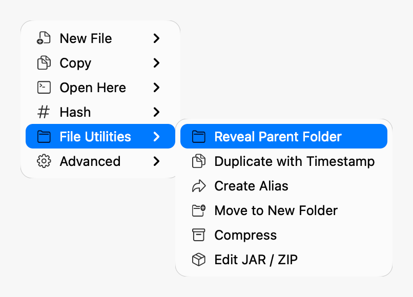

*Native menu views captured with a demonstration ZIP selection and composed at their original positions. Available commands depend on the selection and your menu settings.*

### Quick Features and Finder Cut

In **Quick Features**, enable each feature, record a shortcut, or restore its default. Shortcuts must include Command or Control; duplicate assignments and registration conflicts are reported.

- **Finder Cut — `⌘X`:** select files in Finder, cut, navigate to the destination, then press `⌘V` to move them. Pressing `⌘C` before pasting cancels the pending move. Cut only handles Finder when focus is outside a text field.
- **Screenshot — `⌃⌘S`:** begin on the display under the pointer, then choose a region, the current display, or scrolling capture.

The background service handles shortcuts after you close settings or quit the main app. Signed builds can register it as a login item. Unsigned builds use a session-only service and require reopening ClickMate after logout or restart.

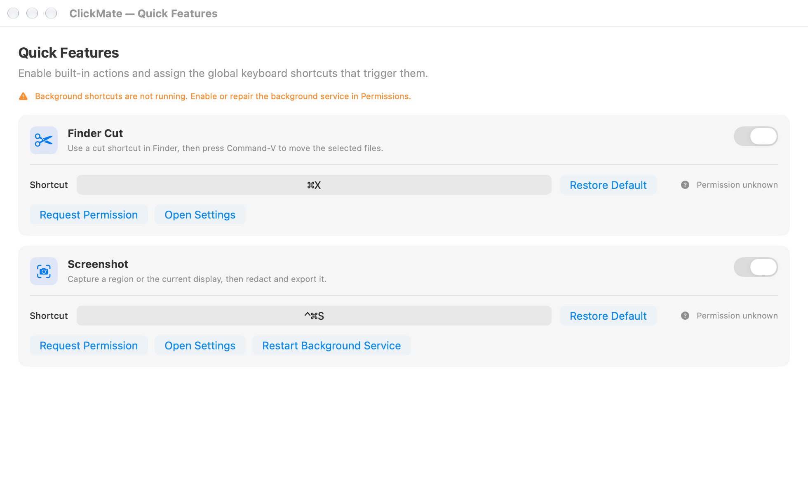

*Demonstration shortcut and service settings. The status on your Mac reflects its actual registration and permissions.*

### Screenshot annotation

Select a region or capture the display under the pointer. Add rectangles, arrows, pen strokes, text, and redaction; adjust colors and line widths; undo, redo, or clear annotations. Copy the result or save it as a PNG. Press `Esc` to cancel capture.

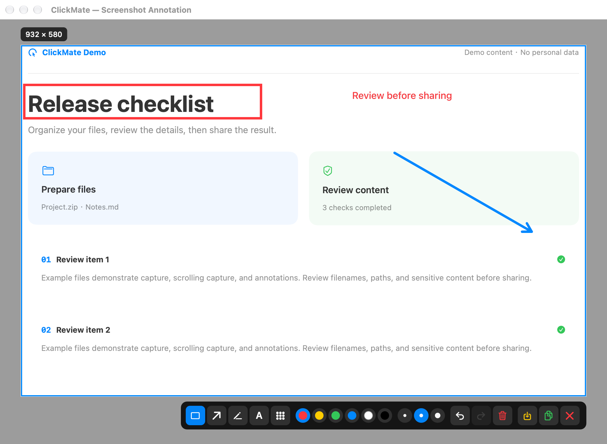

*Native screenshot tools shown on a purpose-built example page; no personal desktop content is included.*

### Scrolling capture

Choose a region and scroll downward slowly, keeping some of the previous content visible so ClickMate can align frames. Pause or continue capture, finish manually, or cancel. Two consecutive frames without overlap pause capture with an adjustment prompt; content already stitched remains available to finish and export. Capture also has time and image-size limits.

The completed image opens in a separate preview window for annotation, clipboard copying, and PNG export.

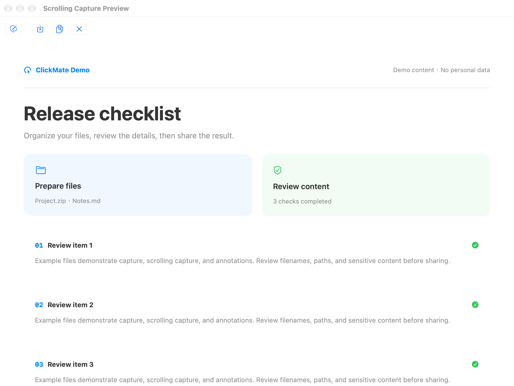

*Native scrolling preview containing a purpose-built example page.*

### ZIP and JAR text editing

Select one `.zip` or `.jar` in Finder and choose **File Utilities → Edit JAR / ZIP**. Browse or search archive entries and edit supported UTF-8 text in a dedicated, resizable window. An optional backup protects the original before the first save; signed JARs display a warning because changing their contents invalidates the signature.

Switching entries, opening another archive, closing the window, or quitting with unsaved edits offers **Save / Discard / Cancel**. A failed save or cancelled signature warning keeps the current edits and window intact. This is a text editor for archive entries, not a binary editor or JAR-signing tool.

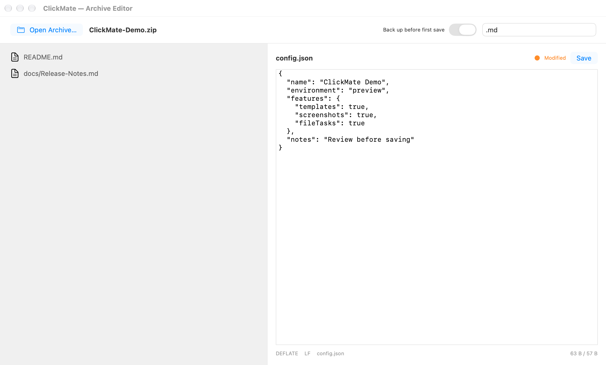

*Disposable example archive with UTF-8 configuration content.*

### File tasks, progress, and recovery

Open **File Tasks** from the settings footer to revisit progress and results, even when notifications are disabled.

- **ZIP compression:** compress one file, multiple selections from the same directory, or folders recursively. Symbolic links are preserved. A single selection uses its base name; multiple selections use “Archive.” Existing names receive a numeric suffix. ClickMate builds and verifies a temporary ZIP before publishing it; failure or cancellation removes temporary output and leaves source files intact. Cross-directory inputs are rejected. Successful output can be revealed in Finder.
- **Hashing:** SHA-256, SHA-1, and MD5 run sequentially in the background using 1 MiB read blocks. See the current file, processed bytes, and overall progress, or cancel. Results copy automatically only when every file succeeds. Partial failures show per-file results and offer **Copy Successful Results**. Cancelling leaves the clipboard unchanged.
- **Batch operations:** timestamped duplicates, aliases, and moves report each source, destination, and error. A failed item does not prevent remaining items from running. Successful moves offer **Restore Original Locations** during the current app session. Recovery skips changed files and occupied original paths without overwriting, and reports failures individually.

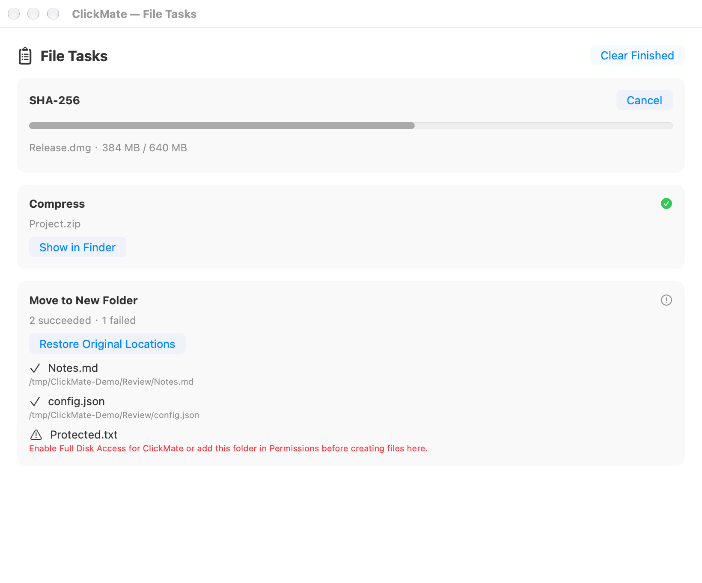

*Demonstration tasks show progress, a partial result, and the recovery action together. Task history and move recovery are limited to the current application session.*

## Customize ClickMate

<details>
<summary>Menus — choose and order commands</summary>

Enable the commands you use, reorder commands, and restore removed defaults. File-creation entries use the templates in **Templates**.

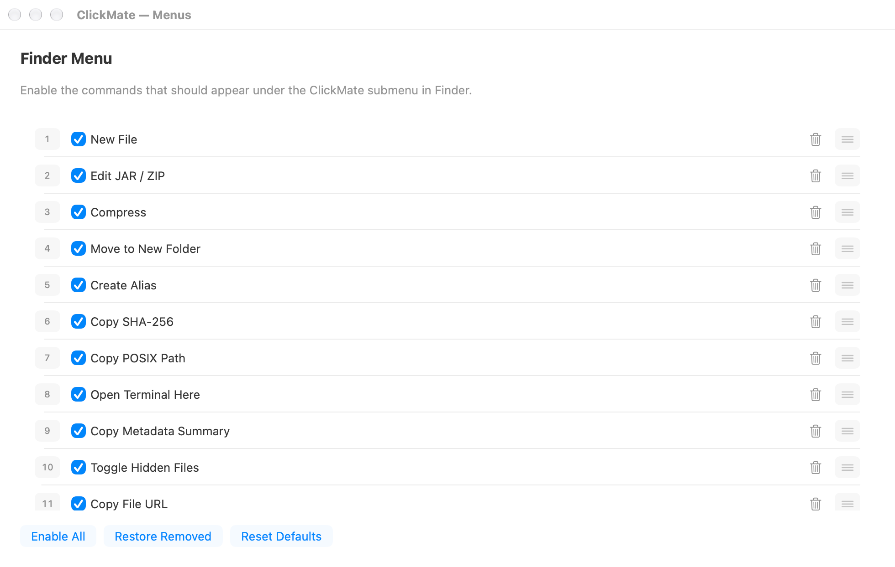

*Example menu configuration.*

</details>

<details>
<summary>Layout — organize submenus and top-level shortcuts</summary>

Choose which groups stay inside the ClickMate submenu and which appear at the top level of Finder's context menu. Add direct shortcuts for selected commands and templates.

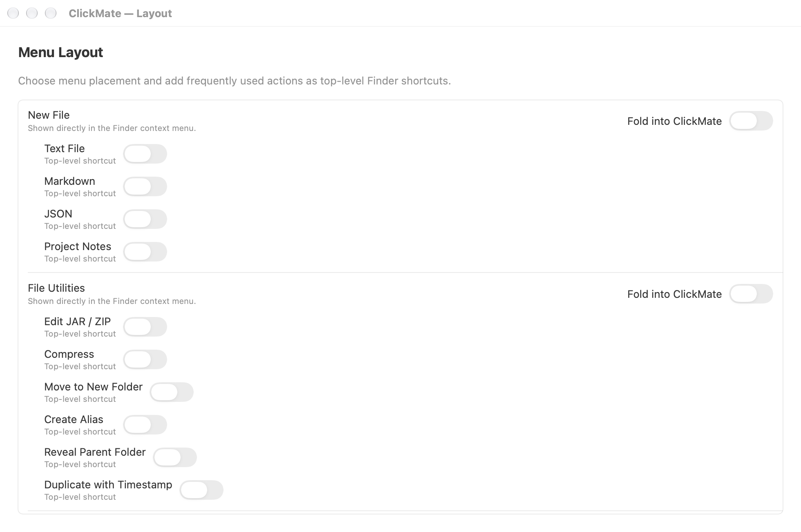

*Example layout configuration.*

</details>

<details>
<summary>Templates — edit filenames and content</summary>

Edit a template's display name, default basename, extension, and text content, or duplicate a built-in template. The extension can be empty. The editor previews the resulting filename and rejects empty names, path separators, and invalid filenames. Changes are saved from a draft; cancelling leaves the stored template unchanged.

Editing preserves the template's ID so existing menu shortcuts continue working. Templates contain literal text; variable expansion and script execution are not supported.

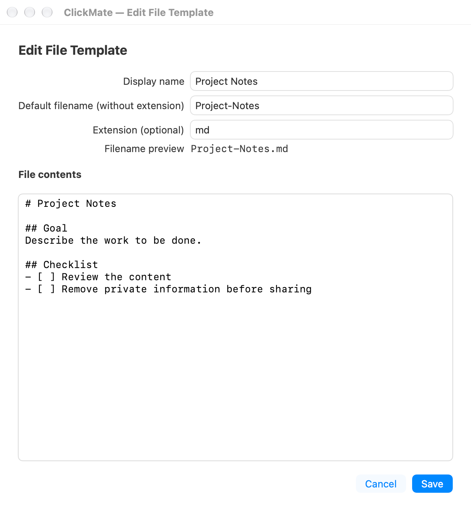

*Demonstration Markdown template.*

</details>

<details>
<summary>Apps — detect editors and pin applications</summary>

Review supported installed applications, refresh detection, reorder entries, or pin another `.app`. Pinned apps appear in **Open with Pinned App**. Removed default entries can be restored.

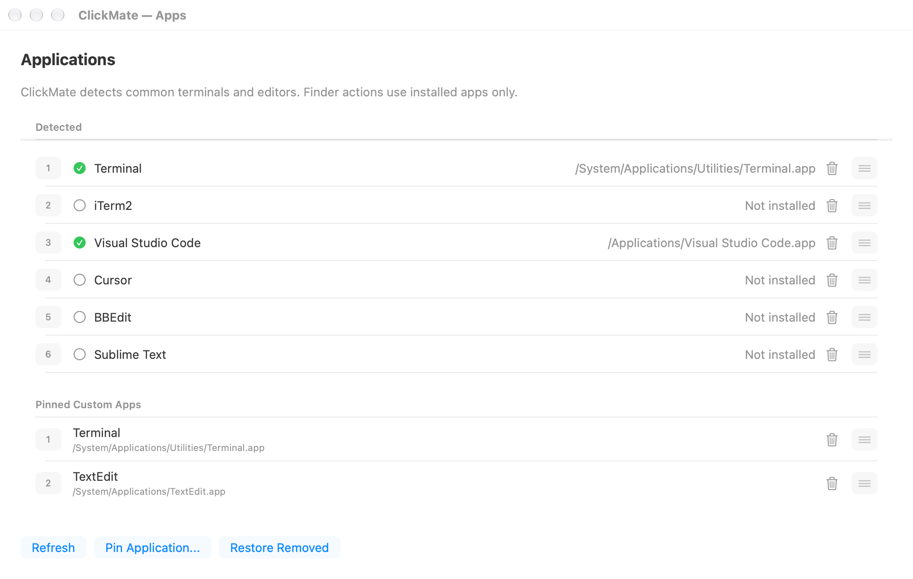

*Example application list using public application paths.*

</details>

<details>
<summary>Permissions — guided setup, trials, and diagnostics</summary>

The guide separates **Finder Tools**, **Finder Cut**, and **Screenshots**, with Available, Setup required, Restart required, or Needs attention states. Try Finder tools in a chosen folder, use the disposable file for the Cut trial, or start and cancel a screenshot trial. Permission readiness does not itself mark a trial as successful.

Expand **All permissions and detailed diagnostics** to inspect the background service, Accessibility, Screen Recording, disk access, Finder extension, and monitored folders. The page provides the relevant System Settings and recovery actions. Authorize additional monitored folders here.

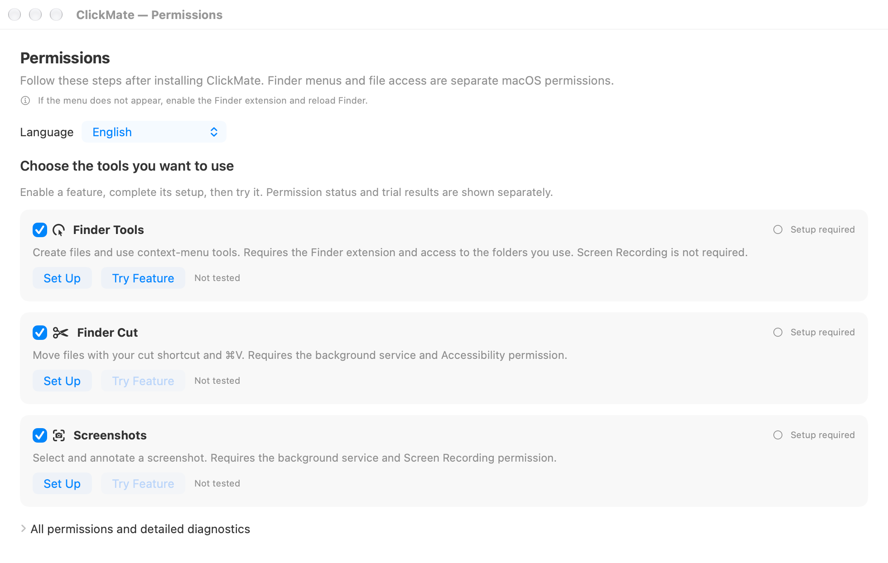

*Demonstration setup and trial states; these are not claims about permissions on your Mac.*

</details>

<details>
<summary>Settings Data — export, import, and recover configuration</summary>

Open **Settings Data** in the settings footer. Versioned JSON exports include menus, templates, shortcuts, screenshot settings, language, and application/folder paths. Preview an import before confirming the replacement; the current valid configuration is backed up first. Unsupported formats and invalid settings do not replace the current configuration.

System permissions, security bookmarks, and local service/runtime state are not transferred. Matching local folder bookmarks are retained; newly imported folders need authorization on this Mac. Exported files contain configured paths and template content, so review them before sharing.

Settings are written atomically with a backup of the most recent valid configuration. A save failure shows its reason and a retry action. A damaged original is retained, with explicit backup recovery or reset instead of silently discarding it.

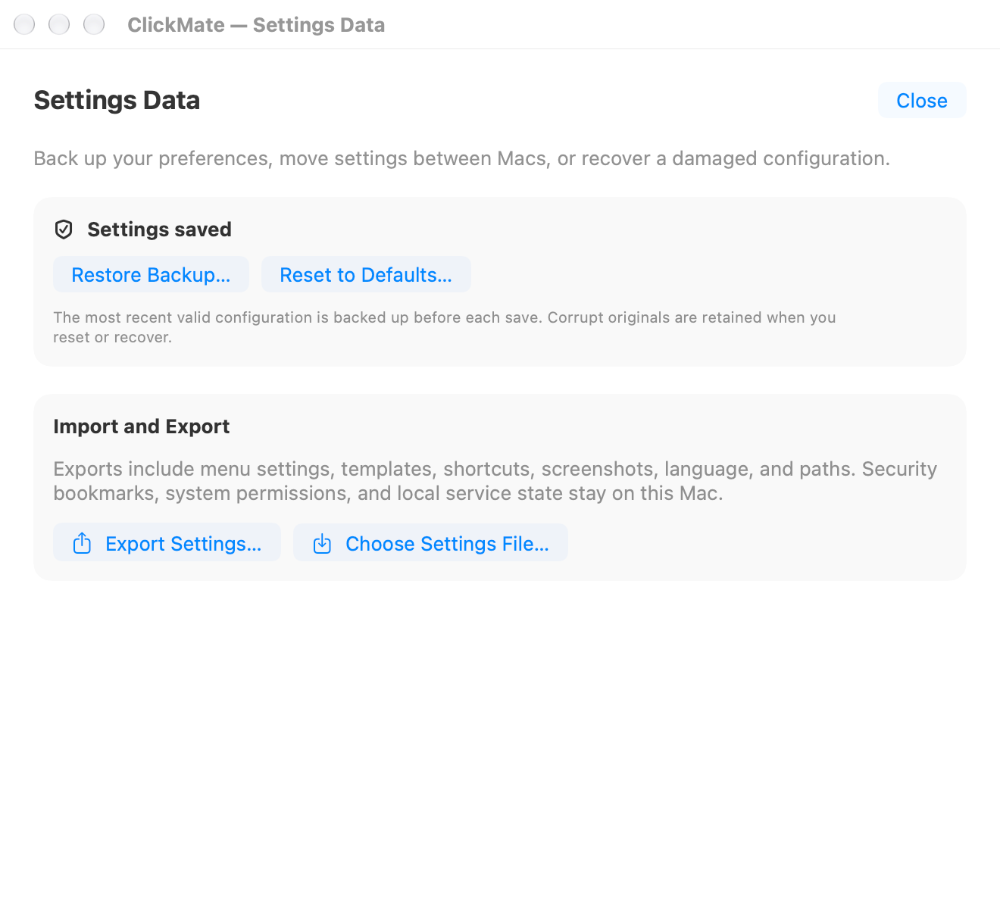

*Demonstration configuration data; no personal paths or authorization bookmarks are included.*

</details>

## Build and distribute

<details>
<summary>Build, test, and analyze locally</summary>

Use Xcode with the macOS SDK. Open `ClickMate.xcodeproj` and select the **ClickMate** scheme. To verify an unsigned local build:

```sh
xcodebuild build -project ClickMate.xcodeproj -scheme ClickMate -destination 'platform=macOS' CODE_SIGNING_ALLOWED=NO
xcodebuild test -project ClickMate.xcodeproj -scheme ClickMate -destination 'platform=macOS' CODE_SIGNING_ALLOWED=NO
xcodebuild analyze -project ClickMate.xcodeproj -scheme ClickMate -destination 'platform=macOS' CODE_SIGNING_ALLOWED=NO
```

A fully functional signed build needs one development team for the main app, Helper, and Finder extension, with the App Group capability provisioned. Enable the Finder extension in System Settings after installing the build.

For the bilingual documentation screenshot workflow, see [Screenshot generation](Scripts/README-screenshots.md).

</details>

<details>
<summary>Package signed, development, or unsigned DMGs</summary>

**Public distribution:** configure a Developer ID Application certificate, an App Group-capable team, and a `notarytool` keychain profile:

```sh
export CLICKMATE_DEVELOPMENT_TEAM='YOUR_TEAM_ID'
export CLICKMATE_SIGNING_IDENTITY='Developer ID Application: Example (TEAMID)'
export CLICKMATE_NOTARY_PROFILE='clickmate-notary'
Scripts/package_signed_dmg.sh
```

The script builds Universal 2 binaries, verifies component identities, provisioning, entitlements, nested signatures, and hardened runtime, then signs, notarizes, staples, and assesses the DMG. Output is under `build/dist/`. The main app, Helper, and extension must retain their fixed bundle identifiers and the same Team ID across releases.

**Local permission and Finder acceptance:** use a stable Apple Development team. This package is for local testing, not public distribution.

```sh
export CLICKMATE_DEVELOPMENT_TEAM='YOUR_TEAM_ID'
# Optional when multiple certificates have the same display name:
export CLICKMATE_DEVELOPMENT_IDENTITY='CERTIFICATE_SHA'
Scripts/package_development_dmg.sh
```

**Unsigned diagnostics:** no development team is required.

```sh
Scripts/package_unsigned_dmg.sh
```

Unsigned packages remove App Group entitlements. Default Finder actions in safe folders can use the URL fallback, but custom Finder settings synchronization, shared runtime status, and automatic permission verification are unavailable. Shortcut service startup is session-only, and rebuilt ad-hoc identities may require permissions again. Use a signed build to validate stable permission identities and the complete shared-queue path.

</details>

<details>
<summary>Publish a GitHub Release manually</summary>

1. Update `CLICKMATE_MARKETING_VERSION` and `CLICKMATE_BUILD_VERSION` in both Debug and Release configurations. Test and commit the release changes, then create and push the matching version tag.
2. Run `Scripts/package_signed_dmg.sh` with the signing and notarization configuration above. Verify the installed package's main app, Helper, Finder extension, version, and both architectures.
3. On the repository's [Releases page](https://github.com/Funnyrz/ClickMate/releases), create a release from that tag, add release notes, upload the signed DMG from `build/dist/`, and publish it. Use a normal release for general updates; drafts and prereleases are not offered as normal updates.

ClickMate checks the latest published release at most once every 24 hours; **Check for Updates** bypasses that interval. A leading `v` in a version tag is ignored for comparison. Updates open the trusted GitHub release page for manual download and replacement; they are not installed silently.

</details>

## Frequently asked questions

**Why is the Finder menu missing or a command unavailable?** Check that the extension is enabled, the folder is monitored and authorized, and the command is enabled. File-specific commands require an explicit selection. Use Permissions diagnostics; if macOS requests a restart, follow that prompt or relaunch Finder after saving ongoing work.

**Why do shortcuts stop working?** Check the background service, shortcut conflicts, and the permission for the background service rather than only the main app. An unsigned build must be reopened after logout or restart. Keep a stable signed app in Applications for routine use.

**Can I recover every move later?** Recovery covers successful batch moves recorded in the current application session. Quitting the app or clearing the finished task removes that recovery record. Changed items and conflicts are skipped; it is not a substitute for a file backup.

**Does importing settings grant access on another Mac?** No. Import transfers portable settings, not system authorizations. Authorize new folders and required features locally.

**Do the screenshots expose a real account?** Documentation images use disposable files, archives, and example pages. Demonstration states are captioned; any remaining personal identifiers are obscured, and published PNGs are re-encoded without source metadata.

## Contributing

Focused fixes, usability improvements, and translations are welcome. Follow the existing Swift/SwiftUI style, add regression coverage for behavior changes, and run the relevant tests. Report macOS version, build/signing type, and reproduction steps when filing an issue; remove personal paths and identifiers from logs and screenshots.

## License

ClickMate is released under the [MIT License](LICENSE).
