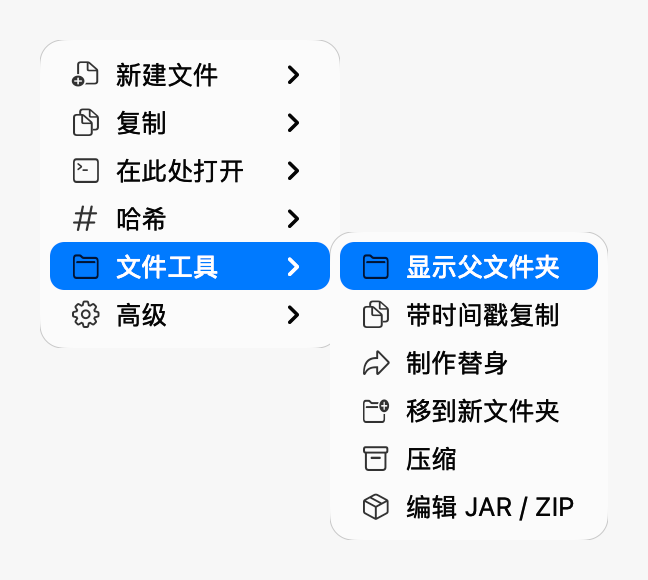
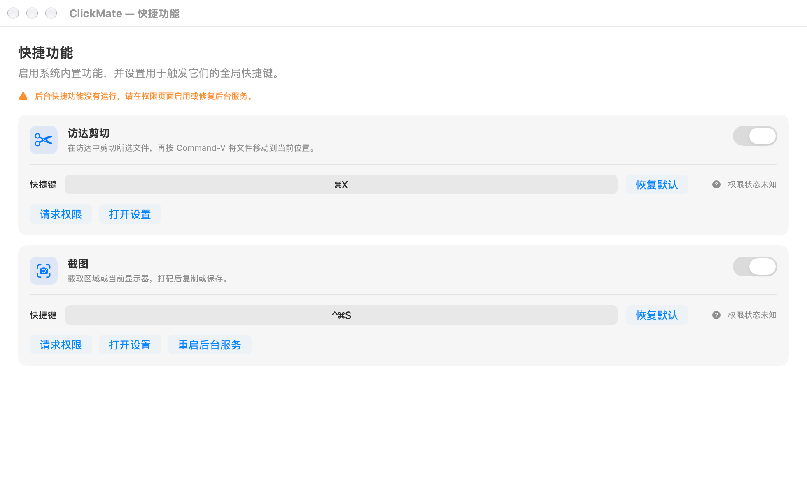
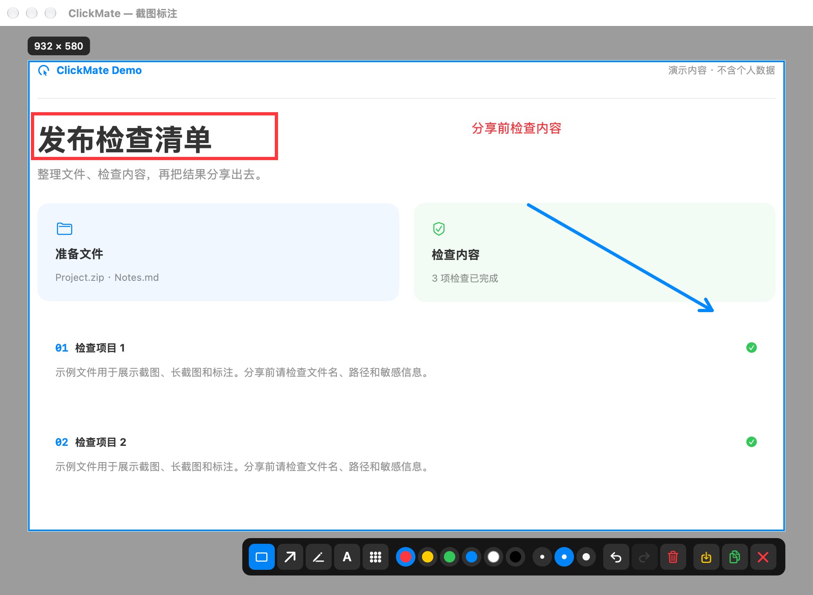
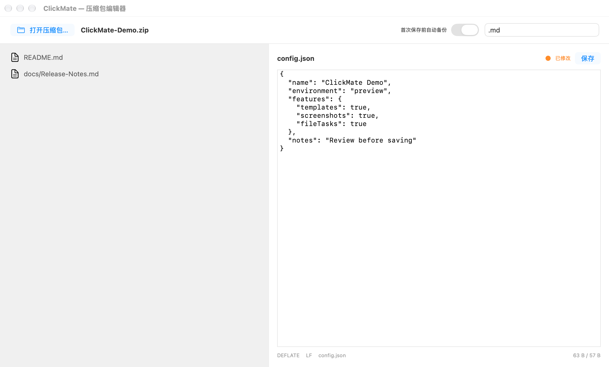
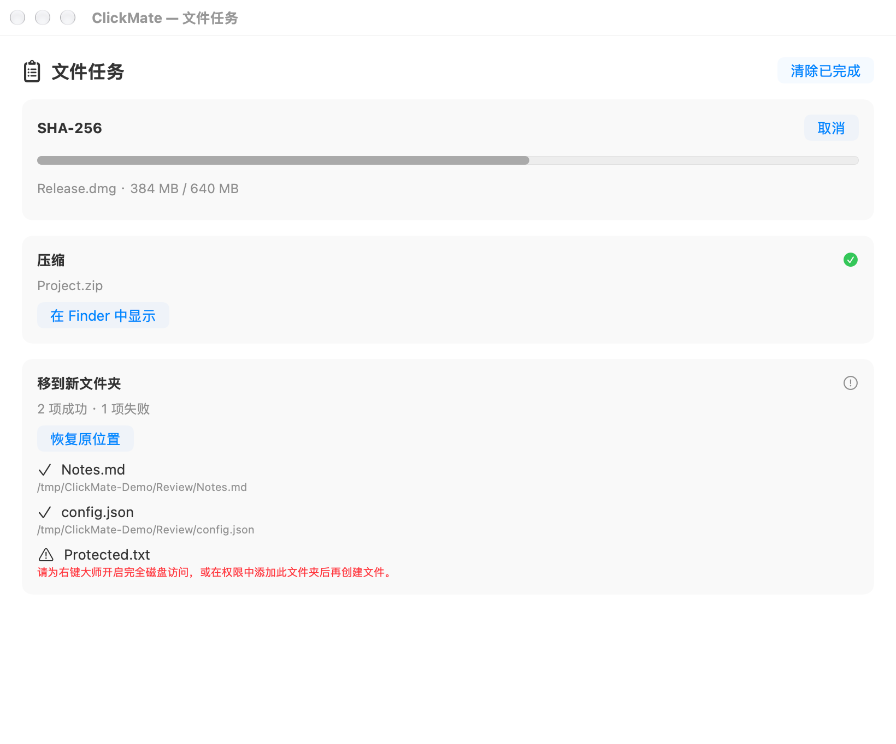
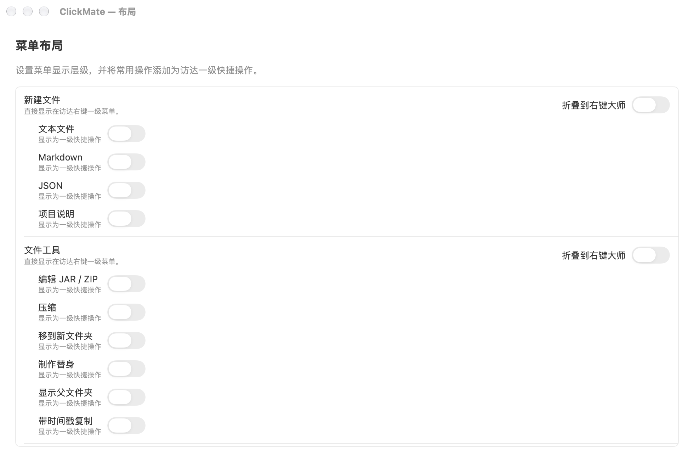
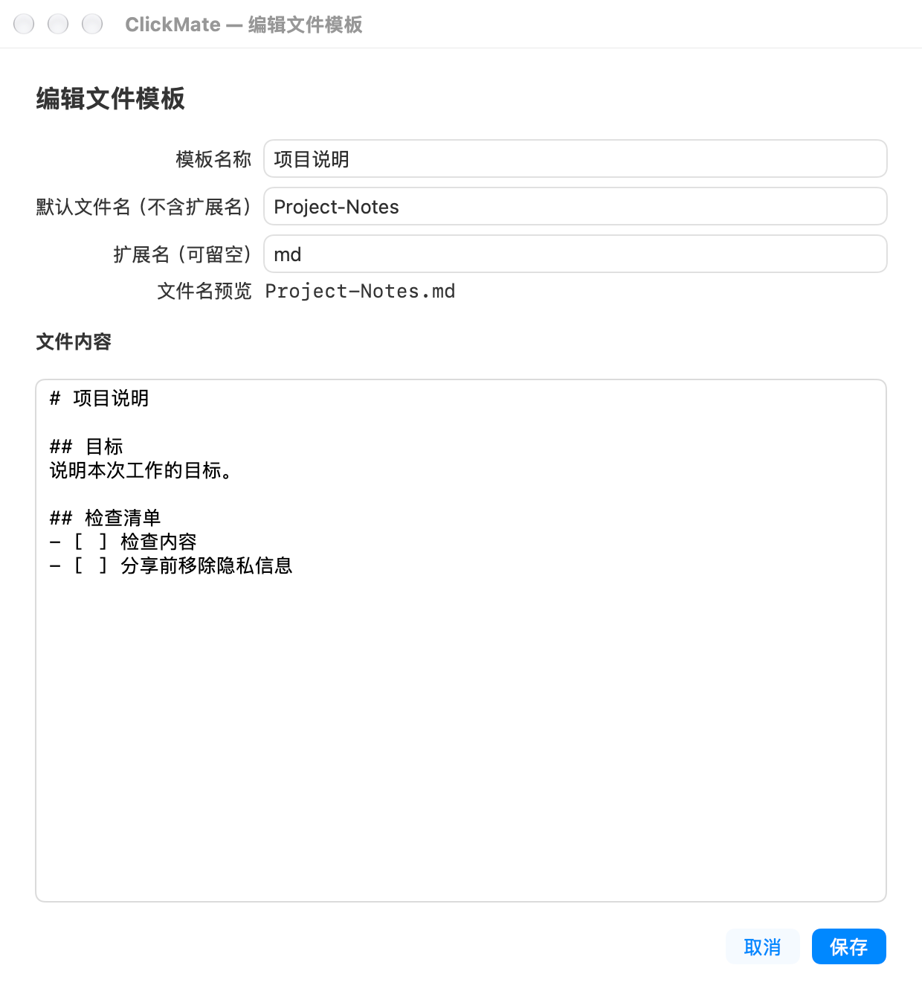
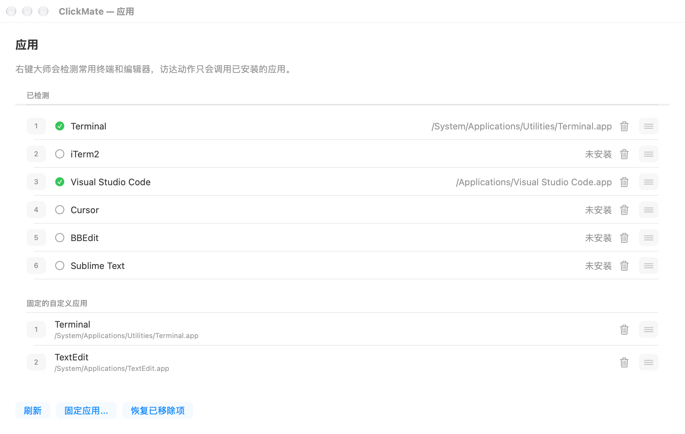

# ClickMate

[English](README.md) · [下载最新版本](https://github.com/Funnyrz/ClickMate/releases/latest) · [MIT 许可证](LICENSE)

ClickMate（右键大师）将常用文件工具带入 Finder：从模板新建文件、复制路径、在编辑器中打开文件夹、压缩所选项目，以及编辑 ZIP/JAR 内的文本。访达剪切与截图工具支持自定义全局快捷键，界面使用 SwiftUI 和 AppKit 原生构建。

**需要 macOS 14 或更高版本。** 正式安装包支持 Apple 芯片和 Intel Mac；只有从源码构建时才需要 Xcode。

## 安装与快速上手

1. 从 [GitHub Releases](https://github.com/Funnyrz/ClickMate/releases/latest) 下载 DMG，将 **ClickMate.app** 拖入**应用程序**后打开。
2. 在**权限**页选择需要的功能，完成对应设置。每项功能都有独立试用入口；权限状态与试用结果分别显示。
3. 使用 Finder 工具时，在系统设置中启用 ClickMate Finder 扩展，并授权需要使用的文件夹。然后在桌面、文稿、下载等已监控文件夹内右键点击文件或空白区域。
4. 在**快捷功能**页启用需要的快捷键，完成对应权限设置后再试用。

| 功能 | 所需条件 |
|---|---|
| Finder 工具 | 启用 Finder 扩展并具有目标文件夹访问权限。访问失败时，可使用文件夹授权与磁盘访问诊断。 |
| 访达剪切 | 启用后台服务，并为 **ClickMate Background Service** 授予**辅助功能**权限。 |
| 截图 | 启用后台服务，并为 **ClickMate Background Service** 授予**屏幕录制**权限。 |

只使用 Finder 工具时，**无需**开启屏幕录制权限。修改权限后如果出现“需重启”，请按提示操作。通知权限为可选项；即使关闭通知，也能从设置底部的**文件任务**查看结果。

## 功能介绍

### Finder 右键菜单

新建文本、Markdown、JSON、CSV、HTML、CSS、JavaScript、Swift、Python 文件，或使用自己的模板。支持复制 POSIX 路径、文件 URL、Shell 转义路径、文件名、基础文件名、扩展名和父级路径，并可在 Terminal、iTerm2、VS Code、Cursor、BBEdit、Sublime Text 或固定应用中打开目标位置。

文件工具提供带时间戳的副本、真正的 Finder 替身、移动所选项目到新文件夹、压缩和压缩包编辑。高级工具支持查看元数据、图片尺寸及切换隐藏文件显示。

菜单会根据上下文调整：空白区域提供新建文件、复制当前目录路径、在此打开和切换隐藏文件；移动、复制文件、制作替身、压缩及针对文件的工具需要明确选中项目。



*使用演示 ZIP 选择上下文采集原生菜单视图，并按原始位置合成。可用命令取决于选中项目和菜单配置。*

### 快捷功能与访达剪切

在**快捷功能**页分别启用功能、录制快捷键或恢复默认快捷键。快捷键必须包含 Command 或 Control；重复设置或注册冲突会显示提示。

- **访达剪切 — `⌘X`：** 在 Finder 中选中文件并剪切，进入目标文件夹后按 `⌘V` 移动。粘贴前按 `⌘C` 可取消待移动状态。仅当 Finder 位于前台且焦点不在文本框内时处理剪切。
- **截图 — `⌃⌘S`：** 从鼠标所在显示器开始，选择区域截图、当前显示器截图或长截图。

后台服务会在关闭设置或退出主应用后继续响应快捷键。签名版本可以注册为登录项；未签名版本使用仅当前登录会话有效的服务，注销或重启后需要重新打开 ClickMate。



*演示快捷键与后台服务设置；你电脑上的状态以实际注册和授权结果为准。*

### 截图与标注

选择区域或截取鼠标所在显示器，添加矩形、箭头、画笔、文字和打码标注，调整颜色与线宽，并可撤销、重做或清除标注。结果可以复制到剪贴板或保存为 PNG；按 `Esc` 取消截图。



*使用专用示例页面展示原生截图工具，不包含私人桌面内容。*

### 长截图

选定区域后缓慢向下滚动，保留部分上一帧内容以便拼接。支持暂停、继续、手动完成和取消。连续两次无法找到重叠区域时会暂停并提示调整；已经拼接的内容仍可完成并导出。捕获同时受到时长和图像尺寸限制。

完成后，图片会在独立预览窗口中打开，可继续标注、复制到剪贴板或导出 PNG。


*原生长截图预览，内容为专用示例页面。*

### ZIP 与 JAR 文本编辑

在 Finder 中选中单个 `.zip` 或 `.jar`，选择**文件工具 → 编辑 JAR / ZIP**，即可在独立、可调整大小的窗口中浏览或搜索条目，编辑支持的 UTF-8 文本。可选择在首次保存前备份原压缩包；修改已签名 JAR 前会提醒，因为修改内容会使原签名失效。

存在未保存修改时，切换条目、打开其他压缩包、关闭窗口或退出都会提供**保存／放弃／取消**。保存失败或取消签名提醒时，会保留当前编辑内容与窗口。该功能面向压缩包内的文本，不提供二进制编辑或 JAR 签名功能。



*使用临时示例压缩包及 UTF-8 配置内容。*

### 文件任务、进度与恢复

从设置底部打开**文件任务**，可重新查看进度和结果，不依赖系统通知。

- **ZIP 压缩：** 支持单个文件、同目录多选及文件夹递归压缩，保留符号链接。单选使用源项目基础名称，多选使用“归档”；重名时添加数字后缀。临时 ZIP 生成并通过完整性验证后才发布到目标位置；失败或取消会清理临时产物，保留原文件。跨目录输入会明确报错。完成后可在 Finder 中显示结果。
- **哈希计算：** SHA-256、SHA-1、MD5 在后台依次处理文件，按 1 MiB 分块读取，显示当前文件、已处理字节与总进度，并支持取消。全部成功后才自动复制结果；部分失败时显示逐项结果，提供**复制成功结果**。取消不会改变剪贴板。
- **批量操作：** 带时间戳复制、制作替身和移动会逐项报告源路径、目标路径和错误。单项失败后继续处理其余项目。成功移动后可在当前应用会话中**恢复原位置**；恢复会跳过已改变的文件及原位置冲突，禁止覆盖，并逐项报告失败原因。



*演示任务同时展示进度、部分成功结果与恢复入口。任务历史和移动恢复仅在当前应用会话内有效。*

## 个性化设置

<details>
<summary>菜单 — 选择命令与调整顺序</summary>

启用常用命令，调整命令顺序，或恢复已移除的默认项。新建文件条目使用**模板**页中的配置。


*示例菜单配置。*

</details>

<details>
<summary>布局 — 组织子菜单与顶层快捷入口</summary>

选择哪些分组折叠到 ClickMate 子菜单，哪些直接显示在 Finder 右键菜单顶层。可为选定命令和文件模板添加直接入口。



*示例布局配置。*

</details>

<details>
<summary>模板 — 编辑文件名与内容</summary>

编辑模板显示名称、默认基础文件名、扩展名和文本内容，也可复制内置模板。扩展名允许留空；编辑器会预览最终文件名，并拒绝空名称、路径分隔符和非法文件名。编辑使用草稿，取消不会改变已保存的模板。

编辑现有模板会保留 ID，使已有菜单快捷入口继续有效。模板仅包含普通文本，不支持变量展开或脚本执行。



*演示 Markdown 模板。*

</details>

<details>
<summary>应用 — 检测编辑器与固定应用</summary>

查看受支持应用的安装状态，刷新检测、调整顺序或置顶其他 `.app`。固定应用出现在**用固定应用打开**菜单中，已移除的默认项可以恢复。



*使用公开应用路径的示例应用列表。*

</details>

<details>
<summary>权限 — 功能引导、试用与诊断</summary>

引导按 **Finder 工具**、**访达剪切**和**截图**分别展示“可用／待授权／需重启／异常”。可以在选定文件夹中试用 Finder 工具，使用临时测试文件试用剪切，或开始并取消截图试用。权限就绪不会自动把试用标记为成功。

展开**完整权限与详细诊断**，可查看后台服务、辅助功能、屏幕录制、磁盘访问、Finder 扩展及监控文件夹状态，并使用对应的系统设置入口和恢复操作。在这里可授权额外的监控文件夹。


*演示设置与试用状态，不代表你电脑上的实际授权结果。*

</details>

<details>
<summary>设置数据 — 导入导出与恢复</summary>

从设置底部打开**设置数据**。带格式版本的 JSON 包含菜单、模板、快捷键、截图设置、语言及应用／目录路径。导入前先预览变更，确认后整体替换；当前有效配置会先备份。未知格式或校验失败不会替换当前配置。

系统授权、权限书签及本机服务／运行状态不会迁移。仍匹配的本机目录书签会保留，新导入目录需在这台 Mac 上重新授权。导出文件包含配置的路径与模板内容，分享前请自行检查。

配置采用原子写入，并备份最近一次有效配置。保存失败时显示原因和重试入口；配置损坏时保留原文件，需明确选择备份恢复或重置，不会静默丢弃。


*演示配置数据，不包含私人路径或授权书签。*

</details>

## 构建与分发

<details>
<summary>本地构建、测试与静态分析</summary>

使用带 macOS SDK 的 Xcode，打开 `ClickMate.xcodeproj` 并选择 **ClickMate** scheme。本地未签名验证命令：

```sh
xcodebuild build -project ClickMate.xcodeproj -scheme ClickMate -destination 'platform=macOS' CODE_SIGNING_ALLOWED=NO
xcodebuild test -project ClickMate.xcodeproj -scheme ClickMate -destination 'platform=macOS' CODE_SIGNING_ALLOWED=NO
xcodebuild analyze -project ClickMate.xcodeproj -scheme ClickMate -destination 'platform=macOS' CODE_SIGNING_ALLOWED=NO
```

完整签名构建需要为主应用、Helper 与 Finder 扩展使用同一开发团队，并配置 App Group 能力。安装后在系统设置中启用 Finder 扩展。

中英文文档配图的生成方法见[截图生成说明](Scripts/README-screenshots.md)。

</details>

<details>
<summary>打包正式签名、开发或未签名 DMG</summary>

**公开分发：** 配置 Developer ID Application 证书、具备 App Group 授权的开发团队及 `notarytool` 钥匙串配置：

```sh
export CLICKMATE_DEVELOPMENT_TEAM='YOUR_TEAM_ID'
export CLICKMATE_SIGNING_IDENTITY='Developer ID Application: Example (TEAMID)'
export CLICKMATE_NOTARY_PROFILE='clickmate-notary'
Scripts/package_signed_dmg.sh
```

脚本构建 Universal 2 二进制，验证组件身份、描述文件、entitlement、嵌套签名与 hardened runtime，然后对 DMG 签名、公证、附加公证票据并评估。产物位于 `build/dist/`。主应用、Helper 和扩展应在版本升级间保留固定 Bundle ID 与相同 Team ID。

**本地权限与 Finder 验收：** 使用稳定的 Apple Development 团队。此包用于本地测试，不用于公开分发。

```sh
export CLICKMATE_DEVELOPMENT_TEAM='YOUR_TEAM_ID'
# 可选：存在多张显示名称相同的证书时指定证书 SHA：
export CLICKMATE_DEVELOPMENT_IDENTITY='CERTIFICATE_SHA'
Scripts/package_development_dmg.sh
```

**未签名诊断：** 不需要开发团队。

```sh
Scripts/package_unsigned_dmg.sh
```

未签名包移除 App Group entitlement。安全目录中的默认 Finder 操作可使用 URL 降级路径，但自定义 Finder 配置同步、共享运行状态和自动权限验证不可用。快捷功能服务仅在当前登录会话中启动，重新构建后的临时签名可能需要重新授权。请使用签名版本验证权限身份稳定性及完整共享队列路径。

</details>

<details>
<summary>手动发布 GitHub Release</summary>

1. 更新 Debug 和 Release 配置中的 `CLICKMATE_MARKETING_VERSION` 与 `CLICKMATE_BUILD_VERSION`，测试并提交发布改动，再创建并推送匹配版本的 tag。
2. 使用上述签名与公证配置运行 `Scripts/package_signed_dmg.sh`，验证安装包中的主应用、Helper、Finder 扩展、版本号和两种架构。
3. 在仓库的 [Releases 页面](https://github.com/Funnyrz/ClickMate/releases)从该 tag 创建发行版，填写更新说明，上传 `build/dist/` 下的正式签名 DMG，再发布。面向所有用户的更新使用普通正式版本；草稿和预发布版本不会作为常规更新提示。

ClickMate 最多每 24 小时自动检查一次最新正式版本，**检查更新**不受该间隔限制。版本比较忽略 tag 开头的 `v`。更新入口打开可信的 GitHub Release 页面，由用户手动下载并替换，不会静默安装。

</details>

## 常见问题

**Finder 菜单没有出现，或某个命令不可用？** 检查扩展是否启用、文件夹是否已监控和授权、命令是否启用。针对文件的命令需要明确选中项目。可使用权限诊断；如系统提示重启，按提示操作，或保存正在进行的工作后重新启动 Finder。

**快捷键为什么失效？** 检查后台服务、快捷键冲突，以及授予后台服务的权限，而不只是主应用权限。未签名构建在注销或重启后需要重新打开；日常使用建议将稳定签名版本保留在应用程序目录。

**所有移动都能以后再恢复吗？** 恢复仅覆盖本次应用会话中记录的成功批量移动；退出应用或清理已完成任务后记录会消失。文件变化或原位置冲突时会跳过，不能替代文件备份。

**导入设置能同时迁移另一台 Mac 的权限吗？** 不能。导入仅迁移可移植设置，新文件夹及所需系统权限需在本机重新授权。

**文档截图是否暴露真实账号？** 配图使用临时文件、压缩包及示例页面；演示状态均有图注。残留个人标识会被遮蔽，发布 PNG 会重新编码并移除源元数据。

## 贡献

欢迎提交聚焦的修复、体验改进及翻译。请遵循现有 Swift／SwiftUI 风格，为行为变更补充回归测试并运行相关测试。反馈问题时请附 macOS 版本、构建／签名类型及复现步骤，并移除日志和截图中的私人路径与身份信息。

## 许可证

ClickMate 使用 [MIT 许可证](LICENSE)开源。
